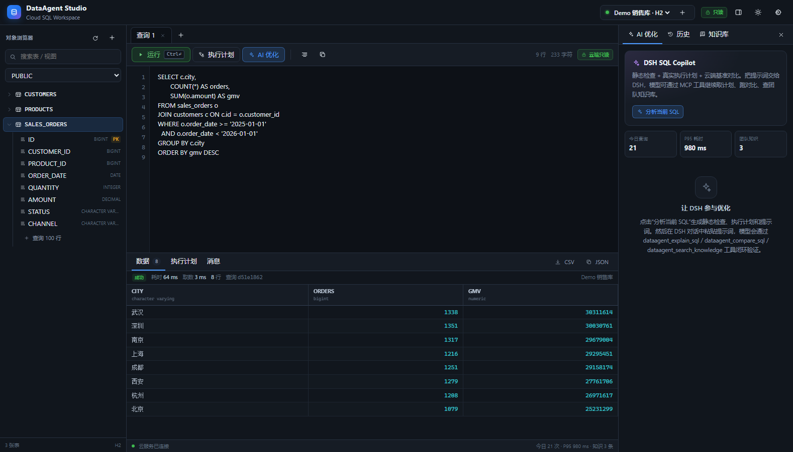
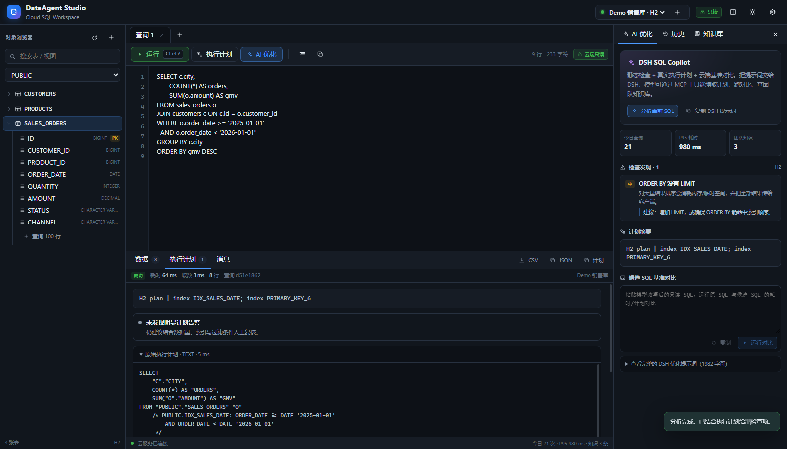
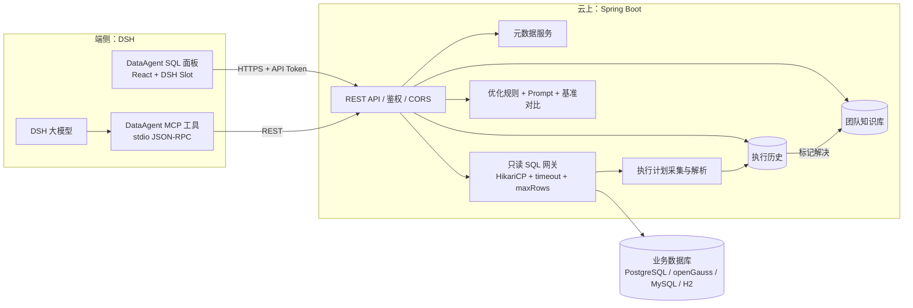

# DataAgent — 端云协同的 SQL 工作台

> DataGrip / Navicat 的内存占用高，SQL 与排查经验只留在个人电脑上。  
> DataAgent 把「执行」放到云端，把「编辑器 + DSH 大模型」留在端侧，把「问题 → SQL → 计划 → 耗时 → 优化结论」沉淀成团队知识库。



## 它解决什么问题

| 现状 | DataAgent 的做法 |
| --- | --- |
| 每个同学本地装一个重型客户端，连接池、驱动、结果集都吃本机内存 | 端侧只是一个轻量 SQL 面板，真正的 JDBC 连接池和执行在云端 |
| SQL 只存在本地文件/历史里，团队无法复用 | 每次执行自动记录 SQL、耗时、行数、执行计划、错误；可一键沉淀为知识条目 |
| 优化靠个人经验，结论散落在聊天记录 | 静态规则 + 真实执行计划 + DSH 大模型 + 云端基准对比，最后写入知识库 |
| 数据库密码散落在个人电脑 | 密码只存云端，AES-GCM 加密；端侧只拿短期 API Token |
| 手工复制 SQL 到 AI 对话，AI 看不到真实计划 | DSH 通过 MCP 工具直接取计划、执行只读查询、跑对比、查知识库 |

## 三个核心能力

1. **云端 Java + Spring Boot**
   - 数据源注册、元数据浏览、只读 SQL 网关
   - 自动采集：SQL、耗时、取数耗时、行数、是否截断、执行计划、错误（Studio 运行默认带计划；云端慢查询自动补计划）
   - 历史检索、问题标注、解决后自动生成知识条目
   - 优化分析：SQL 反模式规则 + 计划洞察 + DSH Prompt 生成
   - 基准对比：原 SQL vs 候选 SQL，记录计划和耗时实验

2. **端侧 DSH 改造**
   - DSH Web UI 侧边栏新增 **DataAgent SQL** 面板
   - 对象浏览器：schema / 表 / 列 / 主键 / 索引
   - 多查询页签、SQL 编辑器、Ctrl+Enter 运行、执行计划、结果表格、CSV 导出
   - 历史与团队知识库检索、一键载入 SQL
   - 优化结论沉淀表单
   - 同一个 React 组件也构建为独立页面：`http://127.0.0.1:8080/studio/`

3. **DSH 大模型 + MCP 工具**
   - 12 个 `dataagent_*` MCP 工具：列数据源、看表结构、只读执行、取计划、分析、对比、搜知识库、保存知识、标记解决、查历史、看统计
   - 面板生成包含 SQL、真实计划、静态发现和约束的 Prompt
   - 模型可继续调用工具验证，而不是凭空给建议
   - 验证后的结论可回写知识库



## 架构



更完整的设计见 [docs/ARCHITECTURE.md](docs/ARCHITECTURE.md)，接口见 [docs/API.md](docs/API.md)，DSH 集成见 [docs/DSH-INTEGRATION.md](docs/DSH-INTEGRATION.md)。

## 快速开始（本地 H2 演示库）

### 0. 环境

- Java 21 + Maven 3.9+
- Node.js 18+ / npm
- 端口 `8080` 可用

### 1. 构建前端（同时生成 DSH 面板 bundle）

> 构建产物 `backend/src/main/resources/static/studio/`、`dsh-plugin/client.js` 和 `backend/target/` 不提交到 Git；首次使用必须先执行本步骤。

```powershell
cd studio
npm install
npm run build
```

### 2. 启动云端

```powershell
cd ..\backend
mvn spring-boot:run
```

或：

```powershell
mvn -DskipTests package
java -jar target/dataagent-cloud-0.1.0.jar
```

### 3. 打开工作台

- Studio：<http://127.0.0.1:8080/studio/>（`/` 也会跳转）
- API 文档：<http://127.0.0.1:8080/swagger-ui.html>
- 健康检查：<http://127.0.0.1:8080/api/health>

默认 API Token：`dataagent-dev-token`（生产必须替换）。  
首次启动会自动创建 H2 演示库：2,000 客户、80 商品、20,000 订单，并预置 2 条知识条目。

### 4. 在 DSH 中安装面板

1. 先确认云端已启动。
2. 打开 DSH 的 **Plugins / 插件** 页面。
3. **Add plugin / 添加插件** → 选择本地目录：`E:\DataAgent\dataagent\dsh-plugin`
4. 启用 `DataAgent SQL` bundle。刷新页面后，左侧栏出现 **DataAgent SQL**。
5. bundle 同时会挂载 `dataagent-mcp`，在对话里可直接使用 `dataagent_*` 工具。

注意：`dsh-plugin/cordis.patch.yml` 里的 MCP 脚本路径是绝对路径。如果仓库移动，请同步修改：

```yaml
args:
  - E:/DataAgent/dataagent/mcp-server/server.js
```

### 5. 验证

```powershell
# 健康
curl http://127.0.0.1:8080/api/health

# 列数据源
curl -H "X-API-Key: dataagent-dev-token" http://127.0.0.1:8080/api/datasources

# 执行只读查询
curl -X POST http://127.0.0.1:8080/api/sql/execute `
  -H "X-API-Key: dataagent-dev-token" `
  -H "Content-Type: application/json" `
  -d '{"datasourceId":"<id>","sql":"SELECT * FROM customers LIMIT 5","maxRows":5}'
```

或运行 `.\scripts\smoke.ps1`。

## 项目结构

```text
dataagent/
├─ backend/                  Spring Boot 云服务
│  ├─ src/main/java/com/dataagent/
│  │  ├─ bootstrap/          演示数据
│  │  ├─ config/             CORS、属性
│  │  ├─ domain/             实体 + 方言
│  │  ├─ repository/         JPA
│  │  ├─ security/           API Token、AES-GCM
│  │  ├─ service/            数据源、元数据、执行、历史、知识库、优化
│  │  ├─ sql/                SQL 守卫、计划解析、规则分析
│  │  └─ web/                REST 控制器 + DTO
│  └─ src/main/resources/
│     ├─ db/migration/       Flyway
│     ├─ static/studio/      构建生成，不入库
│     └─ application.yml
├─ studio/                   React + esbuild 源码（独立页 + DSH Client）
├─ dsh-plugin/               DSH bundle（client.js 构建生成；patch/icon/locale 入库）
├─ mcp-server/              零依赖 MCP stdio 工具桥
├─ docs/                     架构、API、DSH 集成
├─ scripts/                  构建、运行、冒烟
├─ docker-compose.yml
└─ README.md
```

## 配置

| 环境变量 | 默认值 | 说明 |
| --- | --- | --- |
| `SERVER_PORT` | `8080` | 云服务端口 |
| `DATAAGENT_API_TOKEN` | `dataagent-dev-token` | REST API Token，生产必须改 |
| `DATAAGENT_SECRET_KEY` | `dataagent-dev-secret-change-me` | 数据源密码 AES-GCM 密钥，生产必须改且持久化 |
| `DATAAGENT_CORS_ORIGINS` | 本地 49224/5173 | 允许的端侧来源 |
| `DATAAGENT_DEMO_ENABLED` | `true` | 是否创建 H2 演示库 |
| `METADATA_DB_URL` | H2 file `./data/dataagent` | 元数据库；生产用 PostgreSQL |
| `METADATA_DB_USER` / `METADATA_DB_PASSWORD` | `sa` / 空 | 元数据库账号 |
| `DATAAGENT_USER` | `dsh-agent` | MCP 工具调用时写入历史的用户标识 |
| `DATAAGENT_URL` / `DATAAGENT_TOKEN` | `http://127.0.0.1:8080` / dev token | MCP 服务连接云端 |

生产切换 PostgreSQL：

```powershell
$env:SPRING_PROFILES_ACTIVE="postgres"
$env:METADATA_DB_URL="jdbc:postgresql://localhost:5432/dataagent"
$env:METADATA_DB_USER="dataagent"
$env:METADATA_DB_PASSWORD="..."
$env:DATAAGENT_API_TOKEN="<long-random-token>"
$env:DATAAGENT_SECRET_KEY="<32-byte-random-secret>"
java -jar backend/target/dataagent-cloud-0.1.0.jar
```

或直接 `docker compose up --build`（见 `docker-compose.yml`，演示库默认关闭）。

## 安全边界（必读）

- **默认只读**：只允许 `SELECT / WITH / VALUES / SHOW / DESCRIBE`，拒绝多语句、DDL/DML、`SELECT ... INTO`、`EXPLAIN ANALYZE`、`pg_sleep` 等。  
  这不是完整的 SQL 解析器，生产应再加数据库只读账号、网络白名单和审计。
- **密码不落端侧**：端侧只持有 API Token；数据源密码用 AES-GCM 加密后存入云端元数据库。
- **限制结果**：`maxRows` 默认 500（硬上限 5000），查询超时默认 15s（硬上限 60s），避免把云端内存打满。
- **共享 Token 不是 RBAC**：当前 MVP 是单 Token + `X-User-Id` 审计字段。生产应接入 OIDC/SSO、按数据源授权、短期 Token。
- **知识库可能含敏感 SQL**：上线前要做脱敏、访问控制与保留策略。
- **DSH 插件拥有本机 Node 执行能力**：MCP 服务是本地进程，只信任本仓库脚本；不要把第三方 patch 直接装进生产 profile。

## 开发与测试

```powershell
# 后端单元 + 集成测试（20 个）
cd backend
mvn test

# 前端构建
cd ..\studio
npm run build

# 仅查看构建产物
backend/src/main/resources/static/studio/app.js
dsh-plugin/client.js
```

测试覆盖：SQL 守卫、静态规则、计划解析（PostgreSQL/MySQL/H2）、真实 H2 查询、执行计划、知识沉淀、API Token。

## Roadmap

| 阶段 | 内容 |
| --- | --- |
| MVP（当前） | 只读网关、历史、计划、规则优化、知识库、DSH 面板、MCP |
| 下一步 | 数据源级 RBAC、OIDC、SQL 结果脱敏、查询取消、SSE 流式结果 |
| 知识库 2.0 | pgvector 语义检索、LLM 自动摘要/去重、按团队/业务域分层 |
| 血缘增强 | 复用同工作区 `openLine` 的字段级血缘：把表/列影响面加入优化上下文，展示“改这条 SQL 会影响哪些下游字段” |
| 客户端增强 | 虚拟化结果网格、多结果集、事务/写入审批、ER 图、DDL 导出 |
| 生产化 | K8s、连接池隔离、限流、审计、Prometheus/Grafana、灰度 |

## License

MIT。内置演示数据为随机生成，不含真实业务信息。
