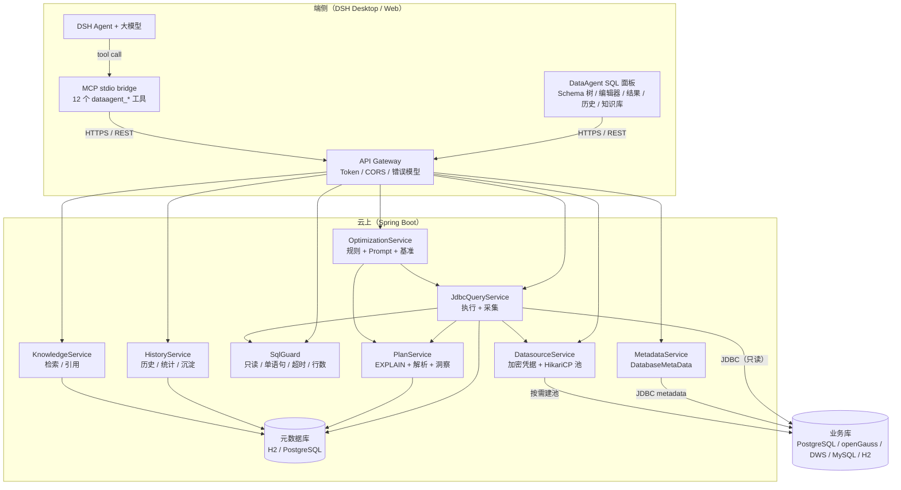
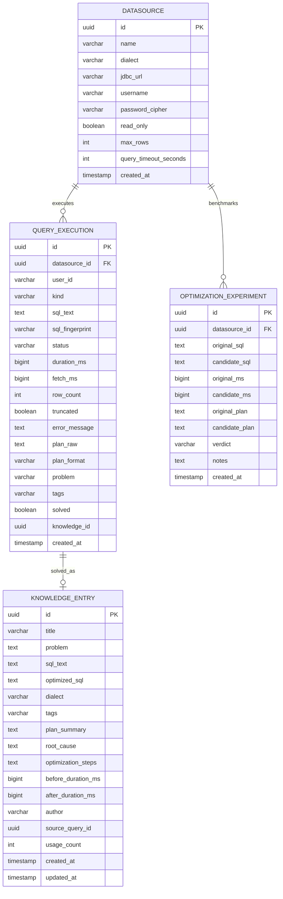
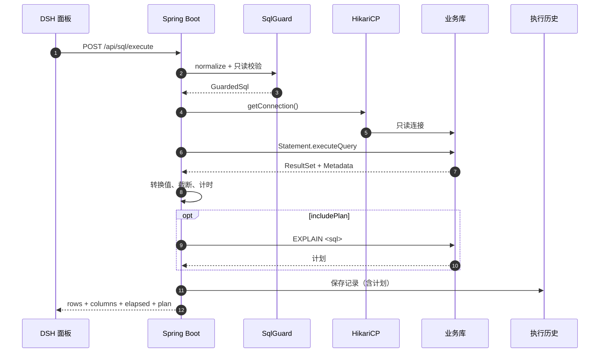
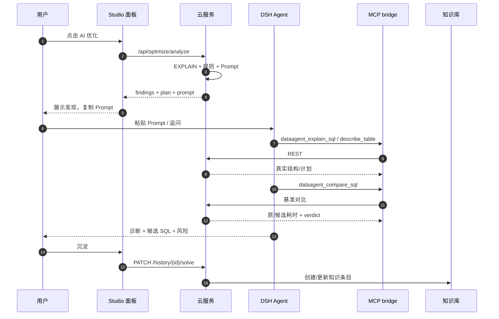
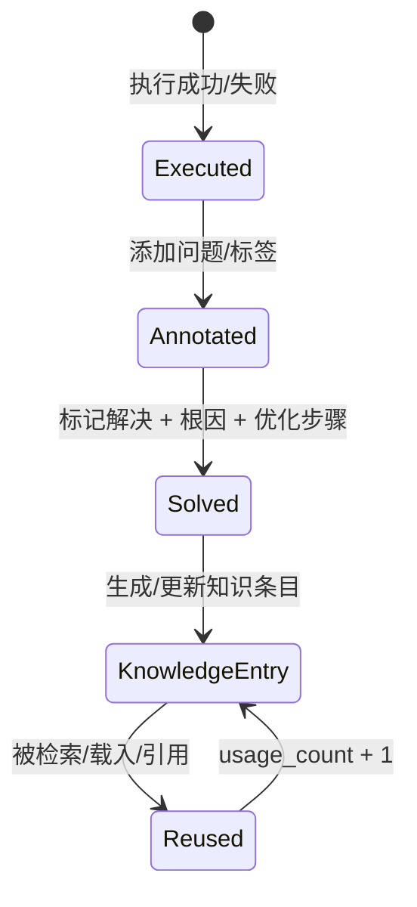

# DataAgent 架构设计

> 版本：0.1（MVP）  
> 目标：把 SQL 执行、计划、耗时和团队经验放到云端，把编辑器和 DSH 大模型留在端侧。

## 1. 目标与非目标

### 1.1 目标

1. 端侧不再维护重型数据库客户端和连接池，降低内存占用。
2. 所有执行可审计：用户、数据源、SQL、耗时、取数耗时、行数、错误、执行计划。
3. SQL 与排查经验可团队共享：从执行历史一键沉淀为知识条目。
4. SQL 优化不是“让模型猜”，而是让模型看到真实执行计划、真实耗时，并能反复调用工具验证。
5. 数据库凭据不落到端侧；端侧只持有可撤销的 API Token。

### 1.2 非目标（当前版本）

- 不替代完整 DataGrip：不做事务编辑、写入审批、ER 图、SSH 隧道、可视化执行计划、自动补全。
- 不做通用 BI：结果集不持久化，只回传当前查询结果。
- 不做完整 SQL 解析器：SQL 守卫是保守的只读网关，不是数据库权限系统。
- 不做多租户计费/配额；RBAC 与 SSO 放在下一阶段。

## 2. 总体架构



### 2.1 端云职责边界

| 能力 | 端侧 | 云侧 |
| --- | --- | --- |
| SQL 编辑、页签、对象浏览 | ✅ | 提供元数据 API |
| 数据库连接/密码 | ❌ | ✅ 加密存储 + 连接池 |
| SQL 执行 | ❌ | ✅ 只读网关、超时、行数限制 |
| 执行计划 | 展示 | ✅ 采集、解析、洞察 |
| 执行历史 | 展示/检索 | ✅ 持久化、统计 |
| 大模型优化 | ✅ DSH LLM | 提供真实计划/基准/知识 |
| 知识库 | 展示/编辑 | ✅ 持久化、检索、权限（后续） |
| 审计 | 只带用户标识 | ✅ 全量记录 |

## 3. 云端模块

### 3.1 API 层

- 所有 `/api/**` 默认要求 `X-API-Key` 或 `Authorization: Bearer`。
- `X-User-Id` 作为审计用户；缺省 `demo`。生产应由网关注入，不能让客户端任意伪造。
- 统一错误体：

```json
{
  "code": "SQL_NOT_ALLOWED",
  "message": "DataAgent 默认只允许只读查询...",
  "path": "/api/sql/execute",
  "timestamp": "2026-10-25T17:00:00Z"
}
```

- CORS 默认允许本地 DSH 端口与 Studio 开发端口；生产通过 `DATAAGENT_CORS_ORIGINS` 收紧。
- OpenAPI：`/v3/api-docs`，Swagger UI：`/swagger-ui.html`。

### 3.2 数据源服务

- 一个数据源对应一个懒加载的 HikariCP 池（最多 5 个连接，探活 1 个）。
- 密码用 AES-GCM 加密，密文存 `datasource.password_cipher`，密钥来自 `DATAAGENT_SECRET_KEY`。
- 支持方言：`POSTGRESQL`（含 openGauss/DWS 的 PostgreSQL 协议）、`MYSQL`、`H2`。
- 连接 URL 白名单：`jdbc:postgresql:`、`jdbc:mysql:`、`jdbc:mariadb:`、`jdbc:h2:`。
- 拒绝 H2 `INIT=` / `RUNSCRIPT`、MySQL 本地文件读取等危险参数。
- 连接创建不做阻塞式强校验；`POST /api/datasources/{id}/test` 显式探活。

> 生产建议：数据源注册只对管理员开放；业务库使用只读账号；通过 VPC/安全组限制云服务出口。当前 MVP 的数据源创建接口没有管理员角色校验，这是已知边界。

### 3.3 元数据服务

- 基于 `DatabaseMetaData`，不依赖数据库特有 catalog 表。
- `schemas`：PostgreSQL/H2 用 schema；MySQL 用 catalog。
- `tables`：表、视图、物化视图；过滤系统 schema。
- `describeTable`：列、类型、可空、默认值、主键、索引。
- 当前不做元数据缓存；高频场景可在下一阶段加 Caffeine + TTL。

### 3.4 SQL 网关

`JdbcQueryService` 的核心约束：

| 约束 | 实现 |
| --- | --- |
| 只读 | `SqlGuard` 首关键字白名单 + 危险关键字扫描；`Connection.setReadOnly` |
| 单语句 | 扫描引号/注释外的分号 |
| 超时 | `Statement.setQueryTimeout`，默认 15s，硬上限 60s |
| 行数 | `Statement.setMaxRows(maxRows + 1)`，默认 500，硬上限 5000 |
| 截断 | 多取 1 行判断是否截断 |
| 事务 | `autoCommit=false` + 最后 rollback，避免驱动隐式提交 |
| 结果大小 | 单单元格字符串默认 20k 字符；二进制 base64 限 64KB |
| 计划 | UI 运行默认采集；慢查询（默认 >=500ms）自动 EXPLAIN；不执行 EXPLAIN ANALYZE |
| 历史 | 成功/失败都写 `query_execution`；计划写入 `plan_raw` |

`SqlGuard` 不是 SQL 解析器：它会把字符串/注释剥离后再做关键字扫描，但仍可能误伤列名、或漏掉非常规语法。**真正的安全边界是数据库只读账号 + 网络 + 审计**。

### 3.5 执行计划服务

按方言生成：

```sql
-- PostgreSQL / openGauss / DWS
EXPLAIN (FORMAT JSON, COSTS TRUE, VERBOSE FALSE) <sql>

-- MySQL
EXPLAIN FORMAT=JSON <sql>

-- H2
EXPLAIN <sql>
```

解析：

- PostgreSQL：`Plan` 树；识别 Seq Scan / Nested Loop / Sort / Hash Join / 高 Total Cost。
- MySQL：`query_block` 树；识别 `access_type=ALL`、无 key、filesort、temporary table。
- H2：文本计划；识别 `tableScan` / FULL SCAN / SORT。
- 原始计划始终保留；解析失败时降级为“保留原文 + 提示无法结构化解析”。

### 3.6 历史与统计

每次执行都写一条 `query_execution`，包括 `kind=QUERY|EXPLAIN`。历史列表默认不返回计划原文，详情才返回，避免列表响应过大。

统计：

- 总查询数、今日查询数
- 平均耗时、P95 耗时（对成功执行排序取分位）
- 慢查询数（`>= 1000ms`）
- 已解决数、知识条目数、数据源数
- 最近查询、最慢查询

### 3.7 知识库

当前是“结构化经验库”，不是文档库：

```
问题/现象 + 原 SQL + 方言 + 标签
+ 执行计划摘要
+ 根因
+ 优化步骤
+ 优化 SQL
+ 优化前/后耗时
+ 作者、来源 queryId、引用次数
```

生成路径：

1. 用户在历史中点击“沉淀”；
2. 填写根因、步骤、优化 SQL、后置耗时；
3. `HistoryService.markSolved` 创建或更新知识条目，并把执行记录标记为 `solved`；
4. 相同 queryId 重复沉淀会更新已有条目，不重复创建。

检索：`title / problem / sqlText / tags` 的 `LIKE` 检索 + 方言/标签过滤。  
下一阶段：pgvector 语义检索、LLM 自动摘要、按业务域/团队分层、去重。

### 3.8 优化服务

`POST /api/optimize/analyze`：

1. `SqlGuard` 校验；
2. 取执行计划（可关）；
3. `SqlAnalyzer` 静态规则：SELECT *、无 WHERE、前置通配符、列上函数、OR、NOT IN、ORDER BY 无 LIMIT、DISTINCT、UNION、隐式 JOIN、IN 子查询、隐式类型转换；
4. 合并计划洞察；
5. 生成 DSH Prompt（含 SQL、计划、发现、约束、JSON 输出 schema）；
6. 返回 findings + plan + prompt。

`POST /api/optimize/compare`：

1. 分别获取原 SQL 与候选 SQL 的计划；
2. 可选真实执行 N 次（默认 2，最多 5），取成功执行的最小耗时；
3. 计算 `improvementPercent = (original - candidate) / original * 100`；
4. verdict：`FASTER / SLOWER / SIMILAR / ORIGINAL_FAILED / CANDIDATE_FAILED / PLAN_ONLY`；
5. 写入 `optimization_experiment`，并附带语义等价性、缓存、单次基准等警告。

> 对比不会自动判断结果集语义是否等价。模型和用户必须自行确认行数、列、排序、去重、NULL 语义。

## 4. 数据模型



**不持久化结果集**：只保存 SQL 与统计，避免把业务数据复制到知识平台。需要导出时由端侧从当前结果生成 CSV。

## 5. 关键流程

### 5.1 执行 SQL



### 5.2 DSH 优化闭环



### 5.3 知识生成



## 6. 端侧 DSH 改造

### 6.1 为什么是插件而不是 fork

DSH 的 Client 是 React + Slot 架构，插件可以注册主面板和侧边栏入口。把 DataAgent 做成 **bundle**：

- 不修改 DSH 安装目录，升级 DSH 不冲突；
- 可独立安装/卸载；
- UI 与 MCP 工具都在一个 bundle 内，安装一次即可；
- 通过 DSH 的 theme/locale/slot 机制融入现有界面。

当前 bundle：

```text
dsh-plugin/
├─ package.json        dsh.bundle.patch + dsh.client
├─ cordis.patch.yml    插入 DataAgent 面板行 + MCP client 行
├─ index.js            Host 入口（空 apply）
├─ client.js           构建后的浏览器 bundle（React external）
├─ locale/zh.json      面板标题/描述
├─ locale/en.json
└─ icon.svg
```

### 6.2 面板能力

- 左侧对象浏览器：schema 切换、表搜索、展开列/主键、点击插入列名、双击插入查询、查询 100 行。
- 中间：多查询页签、SQL 编辑器、行号、运行/计划/AI 优化/格式化/复制、只读标识、耗时/行数状态。
- 结果：数据 / 执行计划 / 消息；CSV 导出、JSON 复制、计划复制；截断标记。
- 右侧：AI 优化（findings、计划摘要、候选 SQL 对比、Prompt）、历史（载入/沉淀）、知识库（详情/载入/引用）。
- 设置：云端地址、API Token、主题；连接注册弹窗。

### 6.3 MCP 工具

`mcp-server/server.js` 是零依赖 Node 进程，使用 stdio 换行分隔 JSON-RPC。工具列表：

| 工具 | 作用 |
| --- | --- |
| `dataagent_list_datasources` | 列连接 |
| `dataagent_list_tables` | 列表/过滤 |
| `dataagent_describe_table` | 列 + 主键 + 索引 |
| `dataagent_execute_sql` | 只读执行 + 历史 |
| `dataagent_explain_sql` | 获取计划 |
| `dataagent_analyze_sql` | 规则 + 计划 + Prompt |
| `dataagent_compare_sql` | 基准对比 + 实验记录 |
| `dataagent_search_knowledge` | 查团队知识 |
| `dataagent_save_knowledge` | 手动沉淀 |
| `dataagent_mark_solved` | 从历史沉淀 |
| `dataagent_search_history` | 查历史 |
| `dataagent_get_stats` | 统计 |

所有工具最终受云端的只读网关约束；模型不能通过 MCP 绕过 `SqlGuard`。

### 6.4 为什么没有把 LLM 调用放进 Java

- 大模型能力属于 DSH 的强项：会话、上下文、工具循环、模型路由、配额都在端侧；
- 云端只提供**事实**（计划、耗时、结构）和**知识**，不重复造 Agent；
- 模型升级/切换不影响云服务；
- 敏感 prompt 与模型供应商由企业 DSH 配置决定。

## 7. 安全模型

### 7.1 威胁

| 威胁 | 缓解 |
| --- | --- |
| 误执行 UPDATE/DELETE | 只读关键字白名单 + 数据库只读账号 + 回滚 |
| 多语句注入 | 引号/注释外分号检测 |
| 查询打爆数据库 | 超时 + maxRows + 只读连接；生产加资源组/限流 |
| 密码泄漏 | 端侧不存密码；云端 AES-GCM；密钥独立管理 |
| Token 泄漏 | 可撤销 Token；生产接 OIDC/短期 Token；TLS |
| 数据源 SSRF | URL 白名单；生产限制可访问网段；数据源注册仅管理员 |
| 知识库泄漏敏感 SQL | 脱敏、访问控制、保留策略；不存结果集 |
| Prompt 注入 | SQL 在 Prompt 中标记为“仅数据”；工具仍受后端约束；模型输出不直接执行写入 |

### 7.2 生产加固清单

- [ ] 替换默认 `DATAAGENT_API_TOKEN` 与 `DATAAGENT_SECRET_KEY`
- [ ] 元数据库使用 PostgreSQL，开启备份
- [ ] 数据源使用只读账号
- [ ] 云服务部署在业务库同 VPC/白名单内
- [ ] 接入 OIDC/SSO，按数据源/团队授权
- [ ] 开启 TLS，限制 CORS
- [ ] 增加查询限流、并发上限、审计导出
- [ ] 知识库敏感字段脱敏
- [ ] 关闭 `dataagent.demo.enabled`
- [ ] 数据源创建接口加管理员角色

## 8. 性能与容量

- 每个数据源独立 HikariCP（max 5），避免一个慢库拖垮全部连接。
- 查询结果只保留在请求内存中，默认 500 行；大结果集应分页/导出。
- 历史表按 `created_at`、`datasource_id`、`sql_fingerprint`、`solved` 建索引。
- 计划原文可能很大，限制 200k 字符；列表不返回原文。
- 统计 P95 当前全量拉取耗时，数据量大时改为 SQL 分位/物化统计。
- 生产建议：查询结果流式返回/SSE、异步大查询、结果缓存、每用户并发配额。

## 9. 可观测性

- Spring Boot Actuator：`/actuator/health`、`/actuator/metrics`、`/actuator/prometheus`。
- 日志：查询失败、数据源注册、计划解析降级。
- 建议补充：
  - Micrometer Timer：`dataagent.query.duration`，按 datasource/dialect 标签；
  - 慢查询告警；
  - 审计日志导出到 SIEM；
  - OpenTelemetry trace：端侧请求 → 云端 → JDBC。

## 10. 部署

### 10.1 本地

H2 file 元数据库 + H2 内存演示库，见 README 快速开始。

### 10.2 Docker Compose

```bash
docker compose up --build
```

- `postgres`：元数据库
- `dataagent`：Spring Boot + Studio
- 演示库关闭；通过 UI/API 注册真实数据源

### 10.3 Kubernetes（建议）

- Deployment + Service + Ingress（TLS）
- 元数据库用托管 PostgreSQL/RDS
- Secret 管理 `DATAAGENT_API_TOKEN` / `DATAAGENT_SECRET_KEY`
- HPA 按 CPU/自定义查询并发指标
- NetworkPolicy 限制只访问指定业务库
- 每环境独立知识库/数据源

## 11. 关键取舍

| 决策 | 理由 | 代价 |
| --- | --- | --- |
| 只读优先 | 避免误写、降低权限要求 | 暂不支持数据修改；写入需独立审批通道 |
| 结果不落库 | 降低敏感数据复制风险 | 不能回放历史结果；只能重跑 |
| 计划可选采集 | 减少正常查询开销 | 优化时需额外 EXPLAIN |
| H2 演示库 | 零依赖启动、可测试 | 与真实数据库优化器差异大 |
| MCP 而非把模型放云端 | 复用 DSH 模型/会话/工具 | 需要端侧安装 bundle |
| 单 Token MVP | 快速验证 | 不是 RBAC；生产需 SSO/授权 |
| 规则 + 计划 + LLM | 便宜、可解释、可验证 | 规则覆盖有限；LLM 仍需人工确认 |

## 12. 演进路线

1. **权限**：OIDC、团队/数据源 RBAC、Token 轮换。
2. **查询体验**：流式结果、取消查询、虚拟化网格、语法高亮/补全。
3. **知识库 2.0**：pgvector、LLM 摘要、自动去重、相似问题推荐、知识审核流。
4. **写操作**：单独审批、事务、影响行数预览、回滚脚本。
5. **可观测**：OTel、慢查询告警、审计看板。
6. **生产化**：限流、配额、多租户、灰度、备份恢复演练。

## 13. 与 openLine 的结合（规划）

工作区里已有 `openLine`（字段级血缘）。下一阶段可以把血缘作为 DataAgent 的“上下文增强”：

- 读取 openLine 的元数据/血缘图，补全表、列、上下游关系；
- 优化 SQL 时提示“该字段被哪些下游任务/报表引用”，避免只改性能不看影响面；
- 知识条目关联血缘节点，按表/字段检索历史优化；
- 当前 MVP 不依赖 openLine，二者可独立运行。

## 14. 代码索引

| 关注点 | 文件 |
| --- | --- |
| 只读守卫 | `backend/src/main/java/com/dataagent/sql/SqlGuard.java` |
| 执行与历史 | `backend/src/main/java/com/dataagent/service/JdbcQueryService.java` |
| 计划解析 | `backend/src/main/java/com/dataagent/sql/PlanService.java` |
| 规则分析 | `backend/src/main/java/com/dataagent/sql/SqlAnalyzer.java` |
| 优化编排 | `backend/src/main/java/com/dataagent/service/OptimizationService.java` |
| 知识沉淀 | `backend/src/main/java/com/dataagent/service/HistoryService.java` |
| DSH 面板 | `studio/src/SqlStudio.jsx` + `dsh-plugin/` |
| MCP 工具 | `mcp-server/server.js` |
| 数据模型 | `backend/src/main/resources/db/migration/V1__init.sql` |
