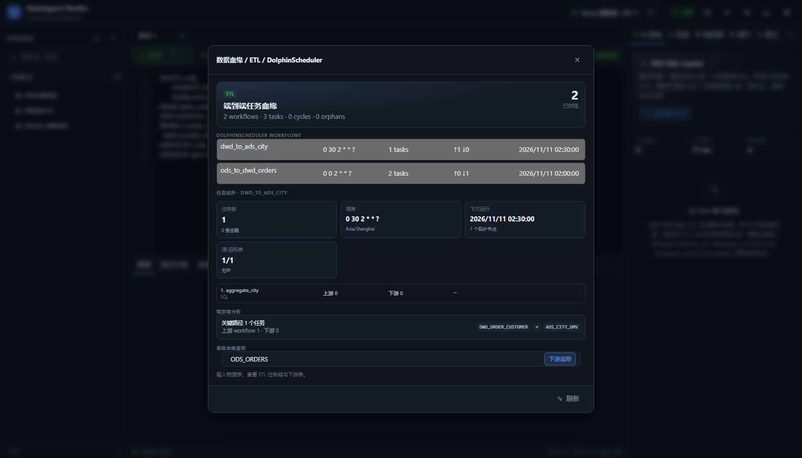

# ETL 与 DolphinScheduler 端到端血缘

> 

## 1. 模型

```text
ETL_WORKFLOW 1 ─── n ETL_TASK
     │                  │
     │                  └── n ETL_TASK_DEPENDENCY
     └── n ETL_WORKFLOW_DEPENDENCY
```

`etl_workflow`：

- `tenant_id`、`source`（MANUAL / DOLPHINSCHEDULER）
- DolphinScheduler `external_id`（process definition code）
- `project`、`name`、`description`
- `schedule_cron`、`timezone`、`release_state`
- `last_synced_at`

`etl_task`：

- `external_id`（DolphinScheduler task code）
- `name`、`task_type`
- `sql_text`
- `source_tables`、`target_table`（由 SQL 自动解析，也允许 DolphinScheduler taskParams 覆盖）
- `config_json`（DolphinScheduler taskParams 原样保留）
- `order_index`、`enabled`

`etl_task_dependency`：

- `upstream_task_id`、`downstream_task_id`
- `condition_type`：`ALL_SUCCESS` / `ONE_SUCCESS` / 其他 DolphinScheduler 条件
- `lag_seconds`

`etl_workflow_dependency`：

- workflow 级依赖，表示 A 完成后才触发 B
- 同样支持 condition/lag

## 2. DolphinScheduler 导入

```http
POST /api/etl/sync/dolphinscheduler
```

支持 DolphinScheduler process definition view 的两种字段名：

- `taskDefinitions` / `taskDefinitionList`
- `taskRelations` / `processTaskRelationList`

示例：

```json
{
  "tenantId": "default",
  "projectCode": 10001,
  "projectName": "sales",
  "processDefinitions": [
    {
      "code": 1001,
      "name": "ods_to_dwd_orders",
      "description": "清洗订单",
      "releaseState": "ONLINE",
      "schedule": {
        "crontab": "0 0 2 * * ?",
        "timezoneId": "Asia/Shanghai",
        "releaseState": "ONLINE"
      },
      "taskDefinitions": [
        {
          "code": 101,
          "name": "extract_orders",
          "taskType": "SQL",
          "taskOrder": 1,
          "taskParams": {
            "sql": "INSERT OVERWRITE TABLE dwd_orders SELECT * FROM ods_orders WHERE status = 'PAID'"
          }
        },
        {
          "code": 102,
          "name": "enrich_customer",
          "taskType": "SQL",
          "taskOrder": 2,
          "taskParams": {
            "sql": "INSERT OVERWRITE TABLE dwd_order_customer SELECT o.*, c.city FROM dwd_orders o JOIN ods_customers c ON c.id = o.customer_id"
          }
        }
      ],
      "taskRelations": [
        {"preTaskCode": 101, "postTaskCode": 102, "conditionType": "ALL_SUCCESS"}
      ]
    },
    {
      "code": 1002,
      "name": "dwd_to_ads_city",
      "schedule": {"crontab": "0 30 2 * * ?", "timezoneId": "Asia/Shanghai"},
      "taskDefinitions": [
        {
          "code": 201,
          "name": "aggregate_city",
          "taskType": "SQL",
          "taskParams": {
            "sql": "INSERT OVERWRITE TABLE ads_city_gmv SELECT city, SUM(amount) FROM dwd_order_customer GROUP BY city"
          }
        }
      ],
      "dependencies": [
        {"upstreamProcessCode": 1001, "downstreamProcessCode": 1002, "conditionType": "ALL_SUCCESS"}
      ]
    }
  ]
}
```

导入行为：

- 以 `(tenant, source, externalId)` upsert workflow
- 删除并重建该 workflow 的 tasks/task deps
- 从 SQL 解析 source/target 表
- 保留 taskParams 到 `config_json`
- 解析 `preTaskCode → postTaskCode` 为任务依赖
- 解析 `dependencies` 为 workflow 依赖
- `lastSyncedAt` 更新
- 写审计 `ETL_SYNC`

### 从 DolphinScheduler REST 拉取

```http
POST /api/etl/sync/dolphinscheduler/pull?projectCode=123
```

配置：

```yaml
dataagent:
  dolphinscheduler:
    enabled: true
    base-url: http://dolphinscheduler:12345
    token: ${DATAAGENT_DS_TOKEN}
    project-code: 123
    project-name: sales
```

客户端：

- `GET /dolphinscheduler/projects/{project}/process-definition`
- 对缺少 task 信息的 definition 再尝试 `.../{code}/view` 和 `.../{code}`
- 兼容标准 DS JSON 与归一化 payload
- 拉取后复用同一导入/重建流程

## 3. 查询接口

```http
GET /api/etl/overview
GET /api/etl/workflows
GET /api/etl/workflows/{id}
GET /api/etl/workflows/{id}/tasks
GET /api/etl/workflows/{id}/task-dependencies
GET /api/etl/workflows/{id}/workflow-dependencies
GET /api/etl/workflows/{id}/graph
GET /api/etl/workflows/{id}/schedule
GET /api/etl/workflows/{id}/analysis
GET /api/etl/lineage?table=ods_orders&direction=downstream&depth=10
```

### graph

- 节点：task id/name/type
- 边：task dependency + condition + lag
- `topologicalOrder`
- `cycles`（Kahn 剩余节点）
- `orphanTasks`
- `sourceTables` / `targetTables`

### analysis

- `schedule`：cron、timezone、nextRun、任务数
- `criticalPathLength` / `criticalPath`
- `topologicalOrder`
- `orphanTasks`
- `upstreamWorkflows` / `downstreamWorkflows`（跨 workflow 依赖链）
- `sourceTables` / `targetTables`

### lineage

从所有 ETL task 构建 **source table → target table** 图：

- `direction=downstream`：从给定表向下游追
- `direction=upstream`：反向追上游
- 每条边带 task/workflow/schedule
- `depth` 控制最大深度
- 返回节点、边、相关 workflow

## 4. 字段级 ETL 映射

`FieldMappingParser` 解析 `INSERT ... SELECT`：

- 目标表：`INSERT [OVERWRITE] TABLE` / `MERGE INTO` / `CREATE TABLE AS`
- 目标列：`INSERT INTO t (col1, col2)` 显式列
- 目标表 schema：通过 `TargetSchemaResolver` 读取数据源元数据，按 ordinal 自动映射真实列名
- 没有显式列且取不到 schema 时，使用 SELECT alias 或 `COL_n`
- 源字段：`alias.column` + `FROM/JOIN ... alias`
- 表达式：保留原始表达式，支持 `CAST`、函数、`*`

持久化到 `lineage_field_edge`，`kind=ETL_TASK`。

接口：

```http
GET /api/etl/tasks/{taskId}/fields
GET /api/etl/field-lineage?table=ODS_ORDERS&column=AMOUNT
POST /api/etl/lineage/rebuild
```

`/api/lineage/field-impact` 的 `fieldEdges` 同时包含 ETL 和 OpenLineage 字段边。

## 5. OpenLineage / Marquez

兼容 Marquez 的采集与查询路径：

```http
POST /api/v1/lineage
POST /api/openlineage/events
GET  /api/openlineage/events?jobName=
GET  /api/openlineage/jobs
GET  /api/v1/namespaces
GET  /api/v1/namespaces/{namespace}/jobs
GET  /api/v1/namespaces/{namespace}/jobs/{job}
GET  /api/v1/namespaces/{namespace}/jobs/{job}/runs
GET  /api/v1/namespaces/{namespace}/jobs/{job}/runs/{runId}
```

支持标准 RunEvent：

- `eventType`、`eventTime`、`run.runId`
- `job.namespace/name`
- `inputs[]` / `outputs[]`
- `facets.columnLineage.fields` → `lineage_field_edge`

采集后自动：

- 写入 `openlineage_event`
- 维护输入表 → 输出表的 `lineage_edge`（kind=OPENLINEAGE）
- 维护字段级边（kind=OPENLINEAGE）
- run 级 API 返回该 run 的 inputs/outputs、tableEdges、fieldEdges
- 在 `/api/lineage/impact` 返回 `openLineageJobs`
- 在 `/api/lineage/field-impact` 返回 OpenLineage 字段边

Marquez 列表接口使用 `{items, totalCount}` 包装。

## 6. 与通用血缘合并

`GET /api/lineage/impact?table=` 现在同时返回：

- SQL 资产
- Verified Query
- 语义实体
- **ETL 任务**

`GET /api/lineage/tables` 的 `etlTaskCount` 统计触达该表的 ETL 任务。

因此一次影响分析可以覆盖：

```text
ODS 表
  ├─ SQL 资产 / 人工查询
  ├─ ETL task (DolphinScheduler)
  ├─ workflow schedule / 依赖
  ├─ DWD 表
  ├─ ADS 表
  └─ 语义实体 / Verified Query
```

## 7. 调度语义

- `schedule_cron` 支持 6 段 Spring Cron 和 7 段 Quartz Cron（自动去掉 year）
- `nextRun` 按 workflow 时区计算
- workflow 依赖表示跨 workflow 的触发顺序
- 任务依赖表示 workflow 内 DAG
- 条件与 lag 仅存储和展示，不执行调度；执行仍由 DolphinScheduler 负责

## 8. 当前边界

- 任务 SQL 解析是启发式，复杂存储过程/动态 SQL 需在 taskParams 中显式提供 source/target
- 目标表 schema 映射依赖 DataAgent 数据源元数据；目标库未注册时回退 `COL_n`
- workflow 依赖的 `conditionType/lag` 是元数据，不在 DataAgent 内调度
- DolphinScheduler 拉取目前是手动触发，尚未接定时同步
- 运行实例当前来自 OpenLineage run；尚未接 DolphinScheduler task instance/SLA
- OpenLineage job/run 查询已对齐主要路径，但未实现 Marquez 全部扩展字段

## 9. 后续

- DolphinScheduler 定时拉取与增量同步
- DolphinScheduler task instance / 补数 / 重跑血缘
- SLA/延迟传播分析
- 补齐 Marquez job/run/dataset 全字段
- 字段级 ETL 与目标 schema 的冲突检测
