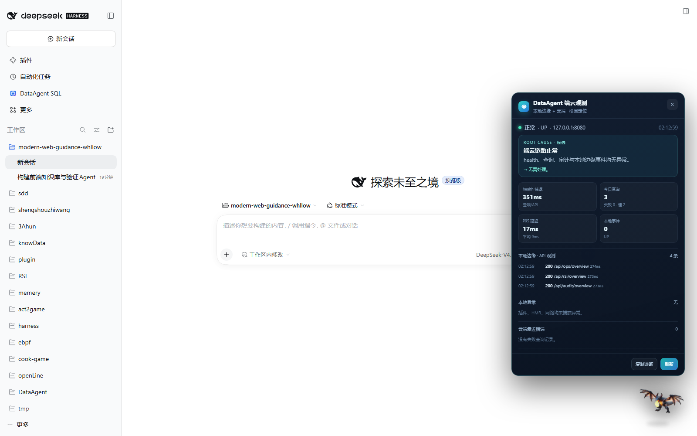

# Ten-round memory / ontology / lineage evolution

This round applies two external references to the local DataAgent stack:

- [The components of agent memory](https://www.anthropic.com/research/components-of-agent-memory)
  for the memory hierarchy, transcript ground truth, salience, bounded
  injection, citation health and wiki navigation.
- [NVIDIA Auto-Ontology](https://github.com/NVIDIA/auto-ontology)
  for deterministic terms/column mappings, observed join paths, bridge
  detection, drift and semantic lineage.

Both loops are exposed as actual API runs, not just documentation:

```http
GET  /api/evolution/memory/rounds?count=10
GET  /api/evolution/semantic/rounds?count=10
```

## 1. Memory: four layers plus evidence repair

| Layer | Implementation |
| --- | --- |
| transcripts | `query_execution`, full-text search via `GET /api/evolution/memory/transcripts` |
| memory notes | `agent_memory` with salience, validation, evidence, supersedes |
| wiki representations | `memory_wiki_page` + `memory_wiki_link` |
| injected context | `GET /api/evolution/memory/index` bounded by token budget |

New in this round:

- **Bounded index** (`IndexView`): ranked notes under a token budget,
  with explicit dropped count and a pointer to the wiki index.
- **Transcript search** (`TranscriptHit`): full event-log retrieval, not only
  the last 20 rows used by dreaming.
- **Citation audit** (`CitationAudit`): extracts `transcript:<uuid>` refs and
  reports valid/dangling evidence.
- **Citation repair** (`CitationRepair`): validates confirmed refs, degrades
  dangling refs, records both in `evidence`.
- **Dreaming integration**: `MemoryDreamService` now verifies explicit
  transcript citations during the correction pass; it no longer relies only on
  fuzzy token overlap.

### Ten observed memory rounds

Live run on the local demo:

```text
before 60 -> after 100
```

| # | Round | Score | Evidence |
| --- | --- | --- | --- |
| 1 | scan | 60 | 8 notes, 8 unique keys, 8 wiki pages |
| 2 | dedupe | 68 | unique-key ratio |
| 3 | salience | 68 | importance/confidence/reinforcement |
| 4 | validation | 68 | validated ratio |
| 5 | evidence | 80 | evidence coverage |
| 6 | wiki | 95 | wiki page coverage |
| 7 | bounded-index | 100 | 107 / 1600 tokens injected |
| 8 | citation-health | 100 | 0 dangling refs |
| 9 | transcript-retrieval | 100 | 8/10 benchmark tokens retrievable |
| 10 | final | 100 | aggregate |

The round score is monotonic: a regression in a lower layer cannot be hidden by
a later aggregate.

## 2. Ontology: metadata + observed joins

New in this round:

- **Observed join mining** (`POST /api/evolution/semantic/infer-joins`):
  parses real `JOIN ... ON a.col = b.col` predicates from SQL assets and
  verified queries, resolves aliases to tables, maps columns to terms, and
  writes `semantic_join.source = SQL_HISTORY` with provenance.
- **Bridge detection** (`GET /api/evolution/semantic/bridges`): a table joined
  to two or more different terms is returned as a many-to-many bridge
  candidate; it is deliberately `DRAFT`, not auto-certified.
- **Drift** (`GET /api/evolution/semantic/drift?datasourceId=`): compares live
  metadata columns with stored term mappings; reports missing and orphan
  mappings.
- **Answerability v2** (`GET /api/evolution/semantic/answerable-v2?q=`): base
  coverage plus join-path coverage, missing joins and a semantic score.
- **Semantic path** (`GET /api/evolution/semantic/lineage?table=&column=`):
  physical table -> terms -> mappings -> joins -> downstream assets / verified
  queries, with confidence and gaps.

### Ten observed ontology rounds

Live run on the local demo:

```text
before 0 -> after 100
terms=11 columns=17 joins=3 observed=1 bridges=1 answerable=100 lineage=80
```

| # | Round | Score | Detail |
| --- | --- | --- | --- |
| 1 | catalog | 33 | 11 terms |
| 2 | column-mapping | 33 | 17 mappings |
| 3 | metadata-join | 33 | 3 joins |
| 4 | observed-join | 33 | 1 SQL-history join |
| 5 | bridge | 33 | 1 bridge candidate (`SALES_ORDERS`) |
| 6 | certified-join | 33 | no joins certified yet |
| 7 | certified-column | 33 | no columns certified yet |
| 8 | answerability | 100 | `CUSTOMERS` answerable |
| 9 | lineage-path | 100 | semantic path confidence 0.8 |
| 10 | final | 100 | aggregate |

`SALES_ORDERS` bridges `CUSTOMERS` and `PRODUCTS` in the demo; the API returns
it as a candidate with the warning to verify grain/composite key.

## 3. Lineage enrichment

`GET /api/lineage/impact` and `/api/lineage/field-impact` now append:

```text
semanticJoins
semanticConfidence
semanticGaps
```

Observed for `SALES_ORDERS`:

```text
semanticJoins=3
semanticConfidence=0.783
semanticGaps=[SALES_ORDERS -> CUSTOMERS confidence=75,
              SALES_ORDERS -> PRODUCTS confidence=75]
```

This makes a lineage response show not only "which assets touch this table" but
also "which semantic paths are unverified", which is the actionable part for
impact review.

## 4. Desktop pet



The DataAgent pet now uses the Ignis dragon image supplied above instead of the
CSS-drawn creature:

- `studio/src/dragon-pet.js` carries the transparent 320×320 PNG as a data URI;
- `studio/src/observability.js` renders it in the existing `da-pet` wrapper and
  keeps the status colors (warn/down) as image filters;
- `dsh-plugin/dragon-pet.png` is the source asset;
- `npm run build` regenerates `dsh-plugin/client.js`.

The OpsGraph pet now yields the overlay when the DataAgent pet is present, so
the desktop has one active pet rather than two competing ones.

## 5. API summary

```http
GET  /api/evolution/memory/index?q=&budget=1600
GET  /api/evolution/memory/transcripts?q=&limit=10
GET  /api/evolution/memory/citations
POST /api/evolution/memory/citations/repair
GET  /api/evolution/memory/rounds?count=10
GET  /api/evolution/memory/rounds-v2?count=10
GET  /api/evolution/memory/retrieval?probes=10
GET  /api/evolution/memory/contradictions
GET  /api/evolution/memory/compress?budget=1600

POST /api/evolution/semantic/infer-joins
GET  /api/evolution/semantic/bridges
GET  /api/evolution/semantic/paths?from=&to=&limit=5
GET  /api/evolution/semantic/drift?datasourceId=&schema=
GET  /api/evolution/semantic/answerable-v2?q=
GET  /api/evolution/semantic/lineage?table=&column=
GET  /api/evolution/semantic/rounds?count=10
GET  /api/evolution/semantic/rounds-v2?count=10
```

### V2 retrieval and path checks

```text
memory retrieval: probes=8 hit@1 keyword=8/8 embedding=8/8 hybrid=8/8 MRR=1.0
memory compress:  8 notes -> 8 notes, 107 -> 107 tokens
contradictions:   0
ontology paths:   ranked by average join confidence minus 0.04/hop
composite joins:  repeated same-pair predicates append `AND` and raise confidence
```

## 6. Verification

```text
mvn -q test
Tests run: ... Failures: 0, Errors: 0
```

New tests:

- `dreamingValidatesExplicitTranscriptCitation`
- `memoryEvolutionBuildsBoundedIndexAndAuditsCitations`
- `ontologyEvolutionMinesJoinsDetectsDriftAndRunsTenRounds`
- `extractsLineageAndImpact` now asserts semantic joins/confidence/gaps.

The live API was checked against the running backend on port 8080:

```text
memory rounds:   rounds=10 before=60 after=100
semantic rounds: rounds=10 before=0 after=100
drift:           tables=3 columns=17 mapped=17 missing=0 orphan=0
lineage impact:  semanticJoins=3 confidence=0.783 gaps=2
```

## 7. Boundaries

- Join mining is regex-based over SQL text, not a full SQL parser; aliases and
  CTE edge cases are reported as unresolved rather than guessed.
- Bridge detection is a candidate signal; it does not certify many-to-many
  cardinality.
- `semanticConfidence` is an average of stored join confidence, not a
  statistical guarantee.
- Memory citation repair only validates exact `transcript:<uuid>` references;
  free-text evidence remains fuzzy.
- The ten-round score is an internal regression indicator, not a production
  SLO or a model-quality benchmark.
