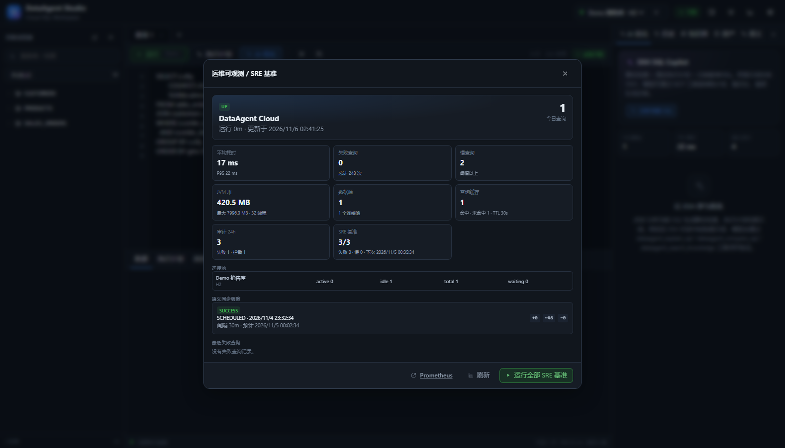

# 治理、缓存与血缘

> 

这层解决 Data Agent 进入生产后的四个问题：**谁做了什么、重复查询是否浪费、并发是否打爆数据源、变更会影响谁**。

## 1. 审计事件

`audit_event` 是不可变追加表：

| 字段 | 说明 |
| --- | --- |
| actor | 请求头 `X-User-Id`，缺省 demo；后台任务为 system |
| action | `SQL_EXECUTE` / `SQL_BLOCKED` / `SQL_EXPLAIN` / `DATASOURCE_*` / `MEMORY_CANDIDATE_*` / `FEEDBACK_SUBMIT` / `QUERY_CACHE_CLEAR` |
| resourceType / resourceId | 资源类型与 id |
| datasourceId | 数据源 |
| status | SUCCESS / ERROR / CACHED |
| detail | fingerprint、rows、elapsed 等；不存全量 SQL |
| clientIp / userAgent | 请求来源 |
| createdAt | 时间 |

审计写入使用 `REQUIRES_NEW` 独立事务，业务失败不会吞掉审计；审计失败也不会影响主请求。

API：

```http
GET /api/audit?actor=&action=&status=&from=&to=&limit=100&offset=0
GET /api/audit/overview
```

`overview` 返回最近 24 小时操作数、失败数、SQL 拦截数、Top 动作。

## 2. 查询结果缓存

- 内存缓存，默认 TTL 30s，最大 200 条
- key = datasource + sql + maxRows + includePlan + autoPlan
- 只缓存 `SUCCESS` 结果
- 数据源更新/删除自动失效
- 请求参数 `fresh=true` 绕过缓存
- 返回体 `cacheHit=true`，UI 显示“缓存命中”
- 统计：`GET /api/ops/cache`，清理：`POST /api/ops/cache/clear`
- 审计记录 `cache=HIT/MISS`

配置：

```yaml
dataagent:
  query:
    cache-enabled: true
    cache-ttl-seconds: 30
    cache-max-entries: 200
```

## 3. 并发保护

- 全局 Semaphore：`max-concurrent-queries`，默认 16
- 每数据源 Semaphore：`max-concurrent-per-datasource`，默认 4
- 超限返回 HTTP 429 + `TOO_MANY_REQUESTS`
- 租约在查询结束自动释放，包括异常路径
- 审计 `SQL_BLOCKED`

配置：

```yaml
dataagent:
  query:
    max-concurrent-queries: 16
    max-concurrent-per-datasource: 4
```

## 4. 表级与字段级血缘

从 SQL 资产、Verified Query 的 SQL 中提取 `FROM / JOIN / UPDATE / INTO / MERGE` 表引用，并识别 CTE，排除 CTE 别名。

```http
GET /api/lineage/tables
GET /api/lineage/impact?table=SALES_ORDERS
GET /api/lineage/fields
GET /api/lineage/field-impact?table=SALES_ORDERS&column=AMOUNT
```

`impact` 返回：

- 引用该表的 SQL 资产（业务问题、SQL 预览、执行次数）
- 引用该表的 Verified Query
- `physicalTables` 包含该表的语义实体

`fields` 通过 `alias.column` 与 `FROM/JOIN ... alias` 解析字段级引用，并附带 `piiType`；`field-impact` 返回引用字段的资产和已验证查询。

用于：

- 表/字段结构变更前评估影响面
- 下线表前确认 Agent 资产
- 语义实体与物理表的映射核对
- PII 字段识别与脱敏策略核对

## 5. 审计导出与保留

```http
POST /api/audit/export
{"from":"...","to":"...","destination":"FILE|SIEM|OBJECT_STORE"}

GET /api/audit/export/download?from=&to=
POST /api/audit/purge
```

- `FILE`：写入 `dataagent.audit.export-dir`，返回路径、行数、字节数、SHA-256
- `SIEM`：POST `application/x-ndjson` 到 `dataagent.audit.siem-webhook`
- `OBJECT_STORE`：PUT 到 `dataagent.audit.object-store-url/<file>`，可带 Bearer token
- 每日 04:30 按 `retention-days`（默认 90）清理
- 导出/清理需要 ADMIN

## 6. 安全与 PII

API Key、角色、租户、数据源 ACL、PII 分类/脱敏见 [SECURITY.md](SECURITY.md)。

## 7. 运维视图

`GET /api/ops/overview` 新增：

- `cache`: hits / misses / puts / evictions / size / ttlSeconds
- `audit`: last24h / failed24h / blocked24h / topActions

Ops 弹窗展示“查询缓存”“审计 24h”卡片。

## 8. 后续路线

- 字段级授权、行级安全、OIDC/SSO
- 审计导出目标增加原生 S3 SigV4
- 分布式缓存与配额的 Redis Cluster 生产化
- 数据源熔断半开探测与自适应阈值
