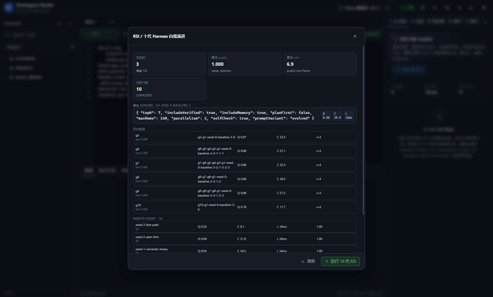

# RSI：递归自我改进特性

参考：

- [Dream-RSI: Recursive Self-Improvement through Evolving Worlds](https://arxiv.org/html/2609.14858v2#S3)
- [Harmony Harness: Multi-Objective Self-Evolution of Agent Harnesses](https://arxiv.org/html/2610.15150v1)

## 1. 论文映射

### Dream-RSI

论文把历史发现组织成 **discovery tree**，用共享决策接口在在线 rollout 与离线 replay 之间复用；策略按 replay objective 选择，目标同时考虑质量、成本和并行度。

DataAgent 的映射：

- discovery tree → `rsi_candidate.parent_id + generation`
- replay → 用 SRE benchmark 历史耗时/状态做候选回放
- shared decision interface → 统一 harness genome
- replay objective → quality / cost / latency + 并行度惩罚
- policy improvement/selection → 每代选择、变异、精英保留

### Harmony Harness

论文把 harness 视为 genome，使用多目标分解和 Tchebycheff 标量化，在局部邻域内进化，并支持推理时动态组合。

DataAgent 的映射：

- harness genome → `rsi_candidate.genome_json`
- 多目标 → quality / cost / latency
- Tchebycheff → 归一化最差 gap 的加权 max
- 邻域/精英 → 每代从当前种群选择父代，保留全局最佳
- 动态组合 → 最佳候选 genome 作为推荐 harness

## 2. Harness genome

```json
{
  "topK": 10,
  "includeVerified": true,
  "includeMemory": true,
  "planFirst": false,
  "maxRows": 100,
  "parallelism": 1,
  "selfCheck": true,
  "promptVariant": "semantic-heavy"
}
```

初始种群：

| 名称 | 特征 |
| --- | --- |
| baseline | topK=4，无 verified/memory/plan/self-check |
| semantic-heavy | topK=10，verified+memory+self-check |
| plan-first | topK=6，verified+memory+plan+self-check |
| fast-path | topK=3，maxRows=50，parallelism=4 |

## 3. 10 代 RSI 循环

```http
POST /api/rsi/runs
{"goal":"evolve DataAgent harness","generations":10,"populationSize":4}
```

每代：

1. 读取当前种群
2. 对每个候选做 replay evaluation
3. 用 Tchebycheff-style 标量化
4. 计算 Pareto front
5. 从种群选择父代
6. 变异 genome
7. 评估子代
8. 与父代比较，保留精英
9. 写 `rsi_generation`、`rsi_candidate`、`rsi_evaluation`

评测指标：

- `quality`：召回/上下文/harness 质量代理
- `cost`：平均 benchmark 耗时 × 行数成本 / 并行度
- `latency`：benchmark 延迟 / 并行度 + planning/context 开销
- `passRate`：benchmark 成功比例
- `scalarScore`：多目标归一化后的选择分数

## 4. API



```http
GET  /api/rsi/overview
POST /api/rsi/runs
GET  /api/rsi/runs/{id}
GET  /api/rsi/runs/{id}/pareto
```

返回：

- run 状态、代数、种群规模
- 每代 population
- 最佳 harness
- Pareto front
- 每代 bestScore

## 5. MCP

- `dataagent_rsi_overview`
- `dataagent_rsi_start`
- `dataagent_rsi_status`
- `dataagent_rsi_pareto`

## 6. 边界

- 当前 replay evaluator 使用 SRE benchmark 历史指标和 harness genome 的可解释代理，不是在线 LLM rollout。
- 演化的是 **harness 配置**，不是模型权重或代码本身。
- 10 代是默认上限；接口允许 1–50 代，种群 2–8。
- 未实现真实分布式并行评测和跨租户隔离实验。
- 最佳 genome 还需人工审核后才能作为生产默认。

## 7. 与 DataAgent 的关系

RSI 优化的是：

- 语义/记忆/已验证查询的召回预算
- 是否启用计划优先
- 是否自检
- 行数上限
- 并行度

这些参数可以直接回写到 Agent harness / DSH 配置，形成“评测 → 选择 → 再评测”的闭环。
