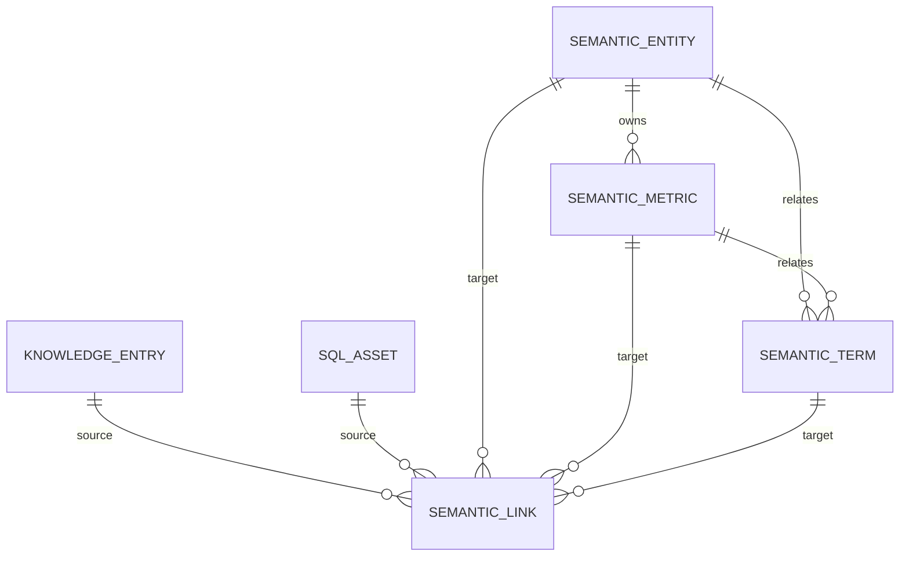

# 语义层与知识库互通设计

> 目标：让“历史 SQL + 业务问题”不仅被保存，还能被语义化、被新功能设计复用、被定期更新。

## 1. 为什么需要语义层

只有 SQL 历史，团队知道“以前怎么查”，但不知道：

- 这个指标的业务定义是什么？
- `GMV`、`成交额`、`销售额` 是不是同一个口径？
- 订单、客户、商品之间是什么粒度？
- 新功能应该复用哪些指标，哪些字段不能下钻？
- 历史 SQL 里的过滤条件是不是临时口径？

语义层把这些隐性知识显式化，作为 SQL 生成、优化、新功能设计和知识库检索的共同上下文。

## 2. 核心对象

| 对象 | 说明 | 典型内容 |
| --- | --- | --- |
| 实体 Entity | 业务对象与物理表的映射 | 客户、商品、订单；主键、粒度、物理表、同义词 |
| 指标 Metric | 可复用的业务度量 | GMV、订单量、客单价；业务定义、表达式、维度、同义词 |
| 术语 Term | 业务词汇表 | 大促、渠道、有效订单；定义、同义词、关联实体/指标 |
| 关联 Link | 知识/资产与语义对象的连接 | `KNOWLEDGE → METRIC`、`SQL_ASSET → ENTITY`；置信度、原因、AUTO/MANUAL |

### 数据关系



## 3. SQL 资产缓存

`sql_asset` 与 `query_execution` 的分工：

- `query_execution`：一次执行的审计记录，保留每次耗时、计划、错误。
- `sql_asset`：按 SQL 指纹聚合的“开发资产”，保留：
  - SQL 文本
  - 业务问题（最重要）
  - 业务域、标签
  - 执行次数、成功/失败次数、平均/最近耗时
  - 最近计划
  - 关联知识条目
  - 最近语义同步时间

写入路径：

1. 每次只读查询执行完，自动 upsert（`source=EXECUTION`）。
2. 用户可在 Studio 的“资产”页手工缓存未执行 SQL（`source=EDITOR`）。
3. 知识条目标记解决时，把知识问题/标签回写到对应 SQL 资产（`source=KNOWLEDGE`）。
4. 历史库已有执行记录时，启动时做一次 backfill。

> 指纹会归一化空白、大小写、字符串/数字字面量，使“同一业务问题换参数”的 SQL 聚合在一起。

## 4. 设计助手

### 输入

```json
{
  "idea": "新增按城市和渠道拆解的 GMV 看板，支持按周对比",
  "domain": "销售",
  "datasourceId": "..."
}
```

### 处理

1. 将想法按空格/标点切词；
2. 匹配实体、指标、术语；
3. 指标自动带出所属实体（例如 GMV → 订单）；
4. 通过 `semantic_link` 找到关联知识条目和历史 SQL 资产；
5. 生成设计角度、待确认问题、风险；
6. 生成 DSH Prompt，交给大模型输出 PRD/数据模型/API/验收 SQL。

### 输出

- `designAngles`：业务目标、指标口径、实体粒度、维度、数据质量、交付路径
- `questions`：粒度、时间范围、权限、对账基准
- `risks`：旧口径、跨实体 JOIN 放大、语义未覆盖
- `relatedKnowledge` / `relatedAssets`
- `promptContext`

这是一套**确定性上下文装配**，大模型负责创造性和结构化输出，避免模型凭空编造指标。

## 5. 定期互通

### 调度

```yaml
dataagent:
  semantic:
    sync-enabled: true
    sync-interval-ms: 1800000       # 30 分钟
    sync-initial-delay-ms: 120000   # 启动 2 分钟后首次
```

也可手动：

```http
POST /api/semantic/sync
```

### 匹配算法（MVP）

1. 扫描全部 `knowledge_entry` 与 `sql_asset`；
2. 对每个语义对象的 `displayName / name / synonyms` 构造别名；
3. 在来源文本（标题、问题、SQL、标签、根因、步骤）中做包含匹配；
4. 每个来源最多保留 12 个高置信度目标；
5. 重建 `link_source=AUTO` 的关联；人工 `MANUAL` 关联不删除；
6. 更新 SQL 资产的 `semantic_synced_at`；
7. 写 `semantic_sync_run` 审计记录（扫描数、新增、更新、删除、状态、错误）。

### 置信度

- 命中显示名：95
- 长别名（>=4 字符）：78
- 短别名：66
- 同源多别名取最高分

> MVP 是关键词匹配，不是语义向量。下一阶段接 pgvector/LLM 判断，并把 `confidence` 作为人工审核排序。

## 6. API 一览

### SQL 资产

| Method | Path | 说明 |
| --- | --- | --- |
| GET | `/api/sql-assets` | 搜索资产（q/domain/datasourceId/page/size） |
| GET | `/api/sql-assets/stats` | 资产总数、有业务问题数、已沉淀数、已关联语义数 |
| GET | `/api/sql-assets/{id}` | 详情 |
| POST | `/api/sql-assets` | 手工缓存 SQL + 业务问题 |
| POST | `/api/sql-assets/import` | 批量导入开发历史 SQL |
| DELETE | `/api/sql-assets/{id}` | 删除 |

### 语义层

| Method | Path | 说明 |
| --- | --- | --- |
| GET | `/api/semantic/overview` | 实体/指标/术语/关联/最近同步 |
| GET/POST | `/api/semantic/entities` | 查询/新增实体 |
| PUT/DELETE | `/api/semantic/entities/{id}` | 修改/删除 |
| GET/POST | `/api/semantic/metrics` | 查询/新增指标 |
| PUT/DELETE | `/api/semantic/metrics/{id}` | 修改/删除 |
| GET/POST | `/api/semantic/terms` | 查询/新增术语 |
| PUT/DELETE | `/api/semantic/terms/{id}` | 修改/删除 |
| GET | `/api/semantic/context?q=` | 匹配实体/指标/术语 + 关联知识/资产 |
| POST | `/api/semantic/design` | 新特性设计助手 |
| GET | `/api/semantic/links?targetType=&targetId=` | 语义对象的知识/资产关联 |
| GET | `/api/semantic/links/source?sourceType=&sourceId=` | 来源对象关联的语义对象 |
| GET | `/api/semantic/{type}/{id}/knowledge` | 关联知识 |
| GET | `/api/semantic/{type}/{id}/assets` | 关联 SQL 资产 |
| POST | `/api/semantic/sync` | 手动同步 |
| GET | `/api/semantic/sync/runs` | 最近同步记录 |

## 7. 业务知识治理

MVP 用简单字段表达治理：

- `owner`：指标/实体负责人
- `status`：`ACTIVE` / `DRAFT` / `DEPRECATED`
- `synonyms`：业务叫法，供匹配和 LLM 使用
- `businessDefinition`：必须写清楚时间窗口、过滤条件、退款/取消/NULL 语义
- `sourceQueryId` / `knowledgeId`：可追溯来源

建议流程：

1. 业务提出新需求；
2. 用设计助手生成初稿；
3. 数据负责人确认实体、指标、维度、口径；
4. 通过 API 或 DSH 工具写入语义层；
5. 知识库/资产定期同步；
6. 上线后用真实 SQL 与指标对账，更新 `status` 和定义。

## 8. 示例：新增“城市 × 渠道 GMV 看板”

语义层匹配：

- 实体：订单
- 指标：成交总额（gmv）
- 术语：GMV、渠道
- 知识：按城市统计 GMV 的慢查询优化记录
- 资产：`SELECT city, SUM(amount) ... GROUP BY city`

设计助手输出：

- 指标：复用 `gmv`，不要新建 `gmv_new`
- 粒度：订单明细 → 城市 × 渠道 × 周
- 维度：城市、渠道、周；退款订单是否计入待确认
- 风险：渠道为空、跨城市客户归属、退款回冲、历史数据回溯
- 验收：与现有 GMV 日报对账；执行计划避免全表扫描

## 9. 下一阶段

- pgvector 语义匹配 + LLM 关系判断，替代纯关键词
- 指标版本化（生效时间、下线时间、变更原因）
- 实体关系图与字段级血缘（复用工作区 `openLine`）
- 人工审核队列：AUTO 关联需确认后才进入正式知识
- 语义层变更影响分析：哪些 SQL/知识/看板引用了该指标
